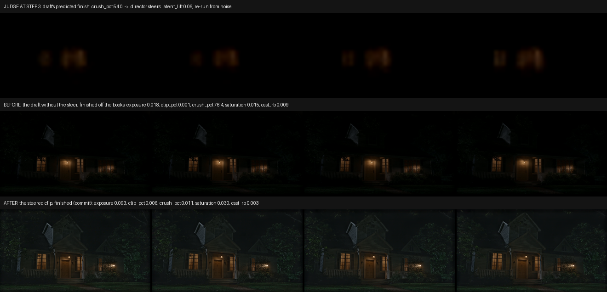

# Latent Judge

**A video model that knows it's failing before it finishes.**

Meta Global AI Developer Hackathon 2026 · Startup track · Push the Frontier · team Atikum
(Kyo Silva, Swarnabha Ghosh)

Demo video: _link_

## What it does

Generative video fails silently. A night shot comes out pure black, a sunny street clips to white, and you only find out
after paying for every step and the decode, by eye.

Latent Judge watches a video generation **while it is still being sampled**. At step 3 of 8 it predicts what the
finished clip will measure: exposure, crushed blacks, clipped highlights, saturation and colour balance. It compares
that against what the shot is meant to look like:

- **pass**: the draft carries on untouched;
- **fail**: the draft is stopped early, and a director agent picks one correction, says why, and the shot is made again;
- every decision is logged with the numbers it was made on.

It runs inside our own sampling loop for LTX-2.5 on cloud GPUs. How the judge reads a draft mid-sampling, and how it
is calibrated per model, is Atikum's own work and is not in this repository.

## Meta models, each with a job

| Model | What it does here |
|---|---|
| **Muse Spark** (Meta Model API) | The director. Reads the shot and chooses what it should be judged against (a night kitchen may be dark on purpose). When the judge stops a draft, it picks **one** correction from a closed menu and has to give a reason. Repeats, no-ops and answers outside the menu fall back to rules. Every call is logged with the model, the response id and the reason. |
| **SAM 3.1** (Meta Model API) | Finds and tracks each person, face, car and light through a clip, so a shot can be judged per object, not only per frame (`sam/`). |
| **Muse Spark + Muse Voice Transcribe** | The pre-cut agent: turns a shoot day's camera files into a labelled take list a director approves before anything is encoded (`precut_agent/`). |
| **Muse Spark Open** | Reads the run history and writes where the model fails by kind of shot, and what to train next. |

## Results

Held out: 30 prompts Muse Spark wrote without seeing our calibration, with seeds and pass marks frozen before the GPU
run (pre-registered 2 Nov 15:19 CET; run A on 3 Nov). Full numbers: [`docs/RESULTS.md`](docs/RESULTS.md).

| | |
|---|---|
| False stops on first drafts (good drafts wrongly stopped) | **0** (pass mark ≤ 1: met) |
| Failures caught by step 3 | 3 of 12 (25 %; pass mark 50 %: **not met**) |
| Failures caught by step 5 | 8 of 12 |
| Delivered and passing | **25 of 30** with the judge and director, 18 of 30 without |

A steer on a held-out prompt ("Moths circle a dim porch bulb outside a dark house at night"): at step 3 the judge
predicts crushed blacks at 54 % against a 20 % limit. Muse Spark steers, the shot is made again, and the delivered
clip passes every check (crushed blacks 0.01 %). Left alone, the draft would have finished at 76 %.

**Known limits, stated plainly.** Step-3 catches missed their mark, because the judge's margin of error is still wide
on night shots. And on this run the director's thinking time (521 s of Spark calls, 268 s after this week's changes)
costs more than the GPU time the gate saved (19 s). Catching failures early is what works today; making the director
cheaper than the drafts it saves is the next step.

## What is in this repository

Everything here was built during the hackathon (27 Oct to 4 Nov 2026).

| Folder | What it is |
|---|---|
| `precut_agent/` | The pre-cut agent, runnable, with tests on a synthetic shoot (`cd precut_agent && pytest -q`, no API key needed: Meta calls are replayed). Needs ffmpeg/ffprobe. |
| `sam/` | The SAM 3.1 client for whole clips through the Meta Model API, and the decoder for its per-object tracks. |
| `docs/` | Results and the steer strip. |

The latent judge, its calibration, the director's code and our experiments stay private: they are the product.
Judges who want to check a number against its source can ask us for read access to the private repository.

Built on our earlier work (the Latent Raw developed-master pipeline), which is not part of this entry.
All footage shown is generated or synthetic; detail added in dark or bright areas is synthesized, never recovered.

Licence: Business Source License 1.1 (see `LICENSE`).
